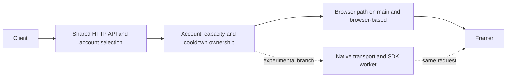

# Serving architecture and branch policy

`main` is the browser-based service. `browser-based` preserves that path as a
maintained fallback. `browserless` is the separate development branch for the
native transport and short-lived SDK worker. A Git push does not deploy either
version or restart the running service.

The browser path uses each account's own session, proxy and browser state.
The resident pool limits how many browsers stay loaded. Request ownership
continues through response streaming and cleanup; uncertain cleanup keeps
the account fenced instead of making it immediately available again.

The browserless path reuses the existing admission and session boundaries.
It must also use the restored shared device and cooldown authority. Starting
a second server with an independent copy of that state is not a safe parallel
test. A bounded real test must send one request through one account owner,
without duplicating paid traffic.

Application code stays in the existing crates: core owns domain policy, server
owns HTTP routing, API owns Framer protocol details, host owns browser/device
integration, and the executable assembles them. Add missing connections at
these boundaries instead of introducing another ownership framework.

## Experimental device lifetime

The native request obtains its saved device from the same restored host that
owns browser cooldowns. The host admits and charges each mint before the SDK
worker starts. It refuses browser work for that account while the native
request remains owned, so the two paths cannot spend independent rate limits.

The application keeps the host grant until the worker, native session and
response cleanup have finished. Cancelling the client does not release that
grant early. A lost cleanup acknowledgement leaves the account fenced.
Successful stream headers can still reach the client before the body ends.

Worker protocol version 2 carries the private saved device through a pipe.
The worker seeds its isolated storage before loading the SDK and checks that
the value remains unchanged. This does not establish upstream acceptance or
prove which identity an opaque token contains. Those require separate evidence.

The generated host package installs the native device adapter after the
existing restoration hook. A base embedded host alone does not provide this
integration; native configuration remains an explicit deployment choice.

The first trial enables `/api/offline/complete` in that same daemon. Ordinary
inference routes keep the browser provider. The trial receives explicit
request context and returns a completed response only after native cleanup.
Enabling its worker configuration does not switch the normal routing policy.
This lets one real request exercise the shared ownership without running a
second account authority or sending duplicate traffic.

## Moving the default

Keep normal browser serving available throughout development. Before moving
`main` to browserless, demonstrate real client delivery, streaming, tool
continuation, cancellation, cleanup and account isolation. Measure the whole
service, including its worker and host processes. An isolated worker peak is
not the service's total memory use.

The wider goal still includes 100 MB total memory, four simultaneous delivered
streams, a 30-minute soak and measurements across ten accounts. These remain
targets, not established results. Preserve the last working browser commit on
`browser-based` when making a later reviewed default change.

## Continuing work around a waiting step

Project progress and runtime admission are separate decisions. A deployment
can wait for authentication or stable account selection while other useful
engineering continues. Keep that dependency attached to the deployment;
never voluntarily treat it as a reason to stop the entire project.

Use the current source and saved evidence to select the smallest independent
implementation or measurement that advances the original objective. Keep an
explicit owner, expected result and next action. Reuse valid results instead
of repeating reviews or polling unchanged prerequisites. A resumed request
requires a fresh assessment of available work.

This does not authorize a second account owner, duplicate traffic, weaker
admission or invented results. Follow mandatory goal-tool status rules only
when their full conditions apply, and explain any required transition.

## Publishing work

Commit and push each coherent milestone to its appropriate branch. Include
the checks performed, any reused evidence and the remaining limitations.
Update `development-status.md` before a handoff. Preserve the original frozen
evidence locally; publish source and a concise account of results, not private
runtime captures or account data.

The browser source includes the base Python host embedded by Rust. The deployed
service also uses a generated cooldown-restoration hook and five support
modules. Keep that runtime packaging distinction explicit when building or
releasing; copying the embedded base host alone does not reproduce the entire
deployed package.
Use `scripts/prepare_browser_runtime.py` to prepare those tracked sources in
a new directory. See `scripts/cooldown_support/README.md` for the boundary
between package generation and an actual coordinated deployment.
