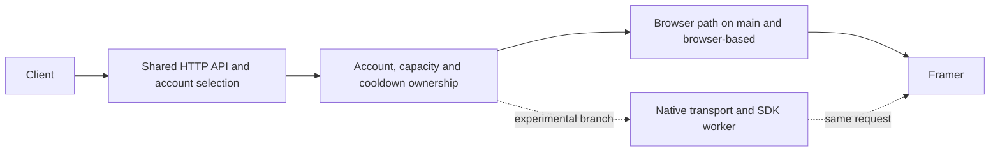

# Serving architecture and branch policy

`main` is the browser-based service. `browser-based` preserves that path as a
maintained fallback. `browserless` is the separate development branch for the
native transport and short-lived SDK worker. A Git push does not deploy either
version or restart the running service.

The browser path uses each account's own session, proxy and browser state.
The resident pool limits how many browsers stay loaded. Request ownership
continues through response streaming and cleanup; uncertain cleanup keeps
the account fenced instead of making it immediately available again.

The browserless path reuses the existing admission and session boundaries.
It must also use the restored shared device and cooldown authority. Starting
a second server with an independent copy of that state is not a safe parallel
test. A bounded real test must send one request through one account owner,
without duplicating paid traffic.

Application code stays in the existing crates: core owns domain policy, server
owns HTTP routing, API owns Framer protocol details, host owns browser/device
integration, and the executable assembles them. Add missing connections at
these boundaries instead of introducing another ownership framework.

## Experimental device lifetime

The native request obtains its saved device from the same restored host that
owns browser cooldowns. The host admits and charges each mint before the SDK
worker starts. It refuses browser work for that account while the native
request remains owned, so the two paths cannot spend independent rate limits.

The source candidate carries that same saved device from the joined worker
result into the private request cookies. It preserves the original login,
rejects conflicting or duplicate device cookies, and never writes the request
snapshot back to the session store. The existing account-generation and private
session checks still apply when those cookies reach the HTTP transport.
This connection is not yet validated or deployed.

The application keeps the host grant until the worker, native session and
response cleanup have finished. Cancelling the client does not release that
grant early. A lost cleanup acknowledgement leaves the account fenced.
Successful stream headers can still reach the client before the body ends.

The deployed disconnect correction separates cancelling future work from
confirming current work. Browser chains stop before another attempt, but keep
the already-started call owned until it returns. Native responses use their
existing completion and cleanup observers. Dropping a response does not itself
prove cleanup, and it must not start another mint or drain an abandoned chain.

For cancellable browser calls, the host returns after one attempt. Rust checks
whether the client is still present before authorizing a retry or optional
refund. An already-started call retains its owner through the real reply, with
one overall deadline. An unknown timeout or refund cleanup remains unconfirmed.
Legacy raw and paid response paths without observers retain their prior limits.

Buffered normal responses carry the observed completion of every account
attempt, including an earlier attempt whose cleanup remains uncertain. A
later successful answer cannot clear that uncertainty. Client disconnect
stops future attempts while the current browser call keeps its owner.
Retry-admission and serialization failures retain that same accumulated
completion outcome, including when the error response is fully consumed.
The browser host records a job-start event after the page has started its
fetch. This lets a live cancellation check observe the actual call boundary
without logging request content, credentials or a response body.

The normal-route recovery check disconnects one unmetered request after that
start event, waits for its actual completion and cleanup, then requires a
complete second response on the same process and runtime configuration.
A restart between those requests cannot establish cancellation recovery.

Worker protocol version 2 carries the private saved device through a pipe.
The worker seeds its isolated storage before loading the SDK and checks that
the value remains unchanged. This does not establish upstream acceptance or
prove which identity an opaque token contains. Those require separate evidence.

The worker's JSDOM window identifies the application as `Framerize/0.1`, the
same identity used by both native HTTP clients. Its resource loader always
returns no resource, including for HTTPS, file and data URLs. This preserves
the isolated page context and does not make JSDOM a browser or prove that
an upstream security check will accept a native request.

The generated host package installs the native device adapter after the
existing restoration hook. A base embedded host alone does not provide this
integration; native configuration remains an explicit deployment choice.

The first trial enables `/api/offline/complete` in that same daemon. Ordinary
inference routes keep the browser provider. The trial receives explicit
request context and returns a completed response only after native cleanup.
Enabling its worker configuration does not switch the normal routing policy.
This lets one real request exercise the shared ownership without running a
second account authority or sending duplicate traffic.

After that request and its cleanup settle, `offline.complete` records only
the upstream status, attempt counters, refusal classification and final cleanup
outcome. It excludes response text, model strings, account identities and request
context. The final cleanup outcome can remain false even when an inner attempt
reports successful cleanup. The event is diagnostic evidence, not a retry signal.
An upstream security refusal and successful cleanup are separate facts. The
refusal classification does not identify whether device state, request context
or another upstream check caused it. Keep that distinction when selecting the
next source correction; a completed rejected attempt is not delivered output.

A browser and native grant cannot use the same account simultaneously. After
the existing host confirms browser closure, the native adapter retains that
browser's actual final device selection in the shared lifecycle. Cooldowns and
request history remain in that same lifecycle. Failed closure transfers no
authority, and an account without a recorded primary device remains ineligible.
The first trial needs an idle account parked through the normal pool owner;
general account availability alone does not establish native readiness.

A support-only release can reuse the verified Rust binary. Bind its changed
support file to separate review evidence, and regenerate only the host's
support-manifest reference. Preserve the previous launch override for rollback.
Carry forward the complete set of retained configuration and override files
from earlier releases. Check every recorded hash and the exact directory
contents before changing the service; keeping only the latest pair loses
the protection for older files that are still installed.

Two releases may use the same executable with different support packages.
Rollback therefore identifies the running generation and launch configuration;
an executable hash alone cannot establish that the old release is running.
The current rollback restores the original executable and launch configuration
while retaining the new restoring host and support package. It preserves the
existing cooldown transfer and verifies the resulting runtime explicitly.

Deployment also has to account for coding sessions using the same daemon.
A maintenance marker controls recovery ownership; it does not stop incoming
requests. Permission to cancel a request is not proof that it has finished.
The transition must still observe fresh zero active work and zero ingress
before capturing state. Preserve a refused execution and arrange a separate
coordinated attempt instead of weakening those checks or overwriting evidence.

Quiet must last through startup, including work generated by the runtime
owner's own coding session. A new service generation can accept requests while
its browsers are still warming. Saved request events must distinguish that
activity from an actually quiet startup; an acknowledgement is insufficient.

A failed startup can leave a restored, serving generation and an owned
maintenance hold. Recovery verification must bind the exact current generation,
original launch configuration, account isolation and restored cooldown state.
Releasing verified recovery bookkeeping does not turn the failed startup into
an accepted deployment or establish browserless delivery. Preserve both results.

Swap in a restored generation can prevent its hold from being released.
A separately bound recovery may treat that exact swapped generation as its
input, then reuse capture, settlement and startup for the installed runtime.
It must preserve cooldowns, account identity, runtime files and hold ownership.
Successful warmup, idle residency and zero current and peak swap are still
required afterward. Accepting a degraded input is not acceptance of a degraded
result. Save new recovery evidence separately from the failed deployment.

Account selection must also remain stable over the accepted startup interval.
A quiet client window does not clear cooldowns or replace that requirement.
Use the recorded expiry times to choose the next attempt, then let the
launcher check current state again. Keep original cooldown timestamps and
the same shared account authority throughout the transition.

Completion evidence belongs to one exact service generation. A later recovery
or restart invalidates its use as current release evidence even when the binary
and sidecar hashes are unchanged. Check the current process, installed files,
accounts, pool, restored state and maintenance ownership before a live test.
Never recreate an old pending handoff merely to make a verifier pass.

A deployment prepared after recovery also binds its preparation and baseline
to the recovered generation. Identical payload bytes do not make the earlier
process identity current. Preserve the old failure and recovery records in the
new release's evidence, and repeat the normal readiness checks before launch.

A refusal before controller launch does not consume a deployment execution.
Preserve that refusal and any expired coordination window. If the missing
resource is restored without changing accepted inputs, record a separate
attempt with fresh coordination and admission against the same accepted plan.
The disk reserve stays fixed; removing verified disposable cache does not
authorize changing it or deleting runtime state and frozen evidence.

The runtime support manifest includes six files, including `native_device.py`.
The completion checker requires all six and verifies their hashes, ownership,
permissions and exact directory membership. Archived handoff copies may prove
historical execution only. Such a result must carry a distinct status that the
live release command rejects.

The optional request observer wraps the existing client checker, verified by
its exact source hash. It samples the shared service's memory during that same
request and retains measurements on failure. It neither owns accounts nor
changes request policy. Its sampled maximum is a lower bound, and concurrent
browser work prevents attributing that maximum to the native request alone.
See [browserless-measurement.md](browserless-measurement.md) for interpretation.

## Moving the default

Keep normal browser serving available throughout development. Before moving
`main` to browserless, demonstrate real client delivery, streaming, tool
continuation, cancellation, cleanup and account isolation. Measure the whole
service, including its worker and host processes. An isolated worker peak is
not the service's total memory use.

The wider goal still includes 100 MB total memory, four simultaneous delivered
streams, a 30-minute soak and measurements across ten accounts. These remain
targets, not established results. Preserve the last working browser commit on
`browser-based` when making a later reviewed default change.

## Continuing work around a waiting step

Project progress and runtime admission are separate decisions. A deployment
can wait for authentication or stable account selection while other useful
engineering continues. Keep that dependency attached to the deployment;
never voluntarily treat it as a reason to stop the entire project.

Use the current source and saved evidence to select the smallest independent
implementation or measurement that advances the original objective. Keep an
explicit owner, expected result and next action. Reuse valid results instead
of repeating reviews or polling unchanged prerequisites. A resumed request
requires a fresh assessment of available work.

This does not authorize a second account owner, duplicate traffic, weaker
admission or invented results. Follow mandatory goal-tool status rules only
when their full conditions apply, and explain any required transition.

## Publishing work

Commit and push each coherent milestone to its appropriate branch. Include
the checks performed, any reused evidence and the remaining limitations.
Update `development-status.md` before a handoff. Preserve the original frozen
evidence locally; publish source and a concise account of results, not private
runtime captures or account data.

The browser source includes the base Python host embedded by Rust. The deployed
service also uses a generated cooldown-restoration hook and five support
modules. Keep that runtime packaging distinction explicit when building or
releasing; copying the embedded base host alone does not reproduce the entire
deployed package.
Use `scripts/prepare_browser_runtime.py` to prepare those tracked sources in
a new directory. See `scripts/cooldown_support/README.md` for the boundary
between package generation and an actual coordinated deployment.
