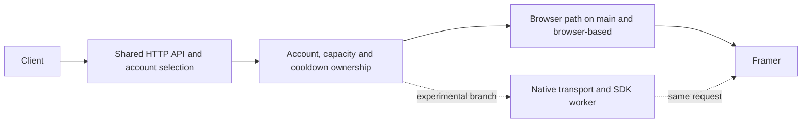

# Serving architecture and branch policy

`main` is the browser-based service. `browser-based` preserves that path as a
maintained fallback. `browserless` is the separate development branch for the
native transport and short-lived SDK worker. A Git push does not deploy either
version or restart the running service.

The browser path uses each account's own session, proxy and browser state.
The resident pool limits how many browsers stay loaded. Request ownership
continues through response streaming and cleanup; uncertain cleanup keeps
the account fenced instead of making it immediately available again.

The browserless path reuses the existing admission and session boundaries.
It must also use the restored shared device and cooldown authority. Starting
a second server with an independent copy of that state is not a safe parallel
test. A bounded real test must send one request through one account owner,
without duplicating paid traffic.

Application code stays in the existing crates: core owns domain policy, server
owns HTTP routing, API owns Framer protocol details, host owns browser/device
integration, and the executable assembles them. Add missing connections at
these boundaries instead of introducing another ownership framework.

## Moving the default

Keep normal browser serving available throughout development. Before moving
`main` to browserless, demonstrate real client delivery, streaming, tool
continuation, cancellation, cleanup and account isolation. Measure the whole
service, including its worker and host processes. An isolated worker peak is
not the service's total memory use.

The wider goal still includes 100 MB total memory, four simultaneous delivered
streams, a 30-minute soak and measurements across ten accounts. These remain
targets, not established results. Preserve the last working browser commit on
`browser-based` when making a later reviewed default change.

## Publishing work

Commit and push each coherent milestone to its appropriate branch. Include
the checks performed, any reused evidence and the remaining limitations.
Update `development-status.md` before a handoff. Preserve the original frozen
evidence locally; publish source and a concise account of results, not private
runtime captures or account data.

The browser source includes the base Python host embedded by Rust. The deployed
service also uses a generated cooldown-restoration hook and five support
modules. Keep that runtime packaging distinction explicit when building or
releasing; copying the embedded base host alone does not reproduce the entire
deployed package.
Use `scripts/prepare_browser_runtime.py` to prepare those tracked sources in
a new directory. See `scripts/cooldown_support/README.md` for the boundary
between package generation and an actual coordinated deployment.
