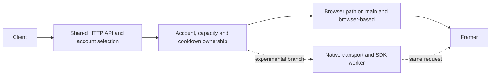

# Serving architecture and branch policy

The isolated V2 diagnostic report projection consumes a bounded private-pipe
report and exports only fixed operation metadata, resource counters and field
structure. Structural entries contain group ID, field ID, type and encoded
byte length. The five group headers plus field lengths must account for the
consumed section exactly. Duplicate JSON keys, unknown fields and malformed
facts refuse the report with a fixed error. Mutable input buffers are cleared
on both outcomes; this is not a secure-erasure guarantee for Python strings.
The projection grants no token, authentication or dispatch authority and is
not connected to serving. The parser and private-pipe owner remain separate.
The diagnostic parser reads exactly groups 0/4/7/8/9, with bounded generic
field encodings and current-source type-7 layouts. It returns the consumed
fingerprint length while leaving events and the final trailer to its caller.
Unknown layouts, duplicate or unordered fields, and invalid lengths refuse
the observation. Neither decoder authenticates or grants use of a token.

V2 window construction uses the existing bounded inline-PNG loader. It accepts
at most four local PNGs per window, each at most 64 KiB and 262,144 pixels,
with either dimension at most 2,048. Other URLs never reach the parent loader.
This enables native image decoding without network or filesystem fetching;
visual mode, workers, SDK configuration and deadlines remain unchanged.
The V2 constructor passes empty loader options so JSDOM retains its original
default navigator user agent. The shared loader's existing user-agent default
remains available to the V3 constructor. JSDOM derives navigator.userAgent
from this loader even when no resource is fetched.

V2 runtimes may provide an asynchronous `closeWorkers` owner hook. The operation
awaits that hook before its final device verification and window closure. A
join failure refuses the token while retaining window cleanup. Runtimes without
workers keep their existing path; adding the hook alone activates no worker.

An explicit `createDedicatedV2Minter` profile installs a bounded worker owner
before SDK configuration. It admits the exact selected worker script by hash
and uses genuine Node worker capabilities. The existing V2 constructors keep
their behavior. The explicit profile requires one started and joined worker,
two delivered messages and zero worker errors before it can release a token.
This is a local completion condition, not evidence of upstream acceptance.
`v2_dedicated_worker.mjs` is a separate explicit resident entry for that profile.
It keeps the existing private handoff protocol and enables the already-bound
resident page URLs. The original V2 worker entry remains unchanged.

The experimental resident structure hook wraps the existing `charged_mint`
method only when an explicit diagnostic package installs it. It observes a
successful result synchronously and returns the same token. Original failures
and cancellation propagate without observation; ordinary observer failures do
not affect the mint. This hook installs nothing when imported.

V2 verifies its pinned SDK, settlement helper and DOM dependencies before and
after the operation using streamed SHA-256 reads with a 64 KiB buffer. Native
libraries are never loaded wholesale just to hash them. Read failures still
close the descriptor and refuse the operation; hash mismatches retain the
existing input-identity failure. This changes verification allocation only,
not SDK selection, identity checks or the configured DOM dependency bundle.

AI POST job failures retain the stage (`fetch` or `body`) and any status
observed after fetch resolves. Both failures still return status `-1`; a
received head never grants completion, provenance or retry authority. The
host removes these diagnostic fields before replying and adds only validated
phase/status facts and the existing opaque job ID to `ai.post`. Missing or
invalid facts add no diagnostic fields. Poll timeouts remain unattributed.
Raw exceptions and response contents are not added to the event.

Resident-enabled hosts also emit fixed RPC method/failure categories. These
labels are diagnostic hints; they do not clear the retained uncertainty
activity or change the original exception. Failure of the observer is ignored.

Resident-enabled hosts retain separate private V2 identity metadata after an
observed successful wrapper call. It binds the original realm, document,
storage object, module and callable. The decorator invokes the wrapper once;
an SDK exception cannot trigger another call through observer error handling.
The SDK seed is never inferred by normalizing the HTTP device. SDK admission
requires a complete V2 baseline observation and the same retained record.
The private begin/complete replies carry `sdk_device`; the daemon validates
its shape and equality after child join. Only the isolated worker receives
that seed. Current cookies, HTTP device, bearer, rate owner and cleanup checks
remain separate. Missing metadata refuses the SDK leg. Ordinary serving still
needs a distinct host-bound SDK-seed grant before using this identity scheme.

The resident SDK coordinator explicitly cancels its worker before awaiting
completion when the cancellation branch wins. This also covers an immediately
ready stop before the result future has been polled and installed its drop
guard. The same completion still owns child reaping; cancellation never grants
cleanup confirmation by itself.

Bootstrap can return a strict unavailable receipt when its constructor finds
no current-document proof before acquiring a lease. The host binds every
identity field and rechecks sidecar incarnation before classifying that call
as having no pending work. This grants no context or token authority. RPC,
post-acquisition and malformed replies keep the existing uncertainty fence.

The private resident control can select V2 with `--resident-v2-worker-config`
alongside its socket option. Invalid configuration fails startup; ordinary
serving and resident controls without this option keep their existing paths.
After a successful browser baseline, `begin_native_sdk` consumes the native
phase and charges the retained account's rate owner before starting a worker.
The original mint lock and resident lease remain held. The daemon joins the
worker, then `complete_native_sdk` rechecks the pinned document and cookie jar
without minting. Only that checked context permits native HTTP, using the same
bearer and current jar. SDK freshness preserves the worker's pre-spawn origin.
Worker and HTTP settlement both contribute to final cleanup; Python's browser
receipt cannot certify the external worker. Any SDK error stops the comparison.
The explicit V2 worker also accepts the captured `/login` and exact `/projects/` dashboard URLs
without replacing them with a constructed editor URL. Project authority still comes from resident
HTTP-200 provenance; default worker URL admission remains unchanged.

`V2Worker` explicitly selects the direct V2 handoff protocol. It shares the
owned subprocess supervisor with `Worker`, whose default remains V3-only.
Typed results are released only after private frame validation, exact metadata
validation and child join. Freshness begins before spawn, never when buffered
bytes are read. V2 failures retain only fixed phase/device labels. A synthetic
socket-denied qualification has exercised the complete private transport;
account binding and resident rate admission remain the next integration step.

The separate `v2_operation`/`v2_runtime` component invokes the retained genuine
V2 factory's configured-instance API. It requires a saved device, calls the
token method once, preserves the supplied target URL, and rejects changed
device state, late completion or failed cleanup. Output is private and
single-use. Its metadata labels direct V2 API selection explicitly; it does
not claim normal wrapper selection. A fresh, bounded, socket-denied process
must own each operation. It is not connected to the existing V3 worker or
serving path, and component completion alone cannot prove child settlement.
Its fixed `device_failure` category is derived from private verifier-error
identity. Arbitrary SDK error properties cannot supply a category. A separate
socket-denied run with a synthetic UUID-shaped device has verified component
completion, unchanged storage and joined child cleanup; its token was discarded.
Private transport and account binding remain separate requirements.

Offline worker target validation accepts the existing bound 20-character
project ID plus alphanumeric access suffix, including the supported slug form.
It preserves the supplied URL exactly and retains origin and route checks.

The isolated R7 control verified completed model output through native HTTP
using a fresh token from its working resident browser. Complete logger windows
recorded V2 for both paired mints. This validates that transport handoff;
it does not validate browserless token generation or change the default service.

Resident native-output evidence is separate from HTTP/JSON and cleanup facts.
Only bounded EOF plus HTTP 200 JSON with completed, nonempty model text sets
`native_output_complete`. Unknown routes, incomplete responses, error objects
and tool-only output do not. It does not change request admission or transport
acceptance. The private socket and client use the same strict 14-field schema.

The resident v2 mint RPC observes only the logger dependency already loaded by
the proven cached `chunk-5LKSDTQ5.mjs` export `a`. Its logger is
`chunk-VJ7UYMJI.mjs`, distinct from the comparison wrapper's dependency.
Each owned mint emits a `resident.mint.sdk` event with lease ID, baseline/native
phase, fixed V2/V3/missing and failure counters, and buffer-window coverage.
No log messages, error payloads, token contents or cookies leave the page in
this metadata. The observer changes no logger settings or SDK fallback.
Unsupported wrappers or malformed observations report unavailable; gaps or
lost buffer anchors report incomplete coverage. Neither result alters token
acceptance. Counters alone do not attest a branch when coverage is incomplete
or competing labels appear. Metadata is stripped before strict token-result
validation and is emitted inside the retained RPC owner, including when its
waiter disappears or a later context check refuses. V1 is unchanged.
The wrapper can fall back to V2 when its initial V3 readiness wait expires
without emitting a V3 error record. Absence of a failure counter proves no
initialization or timing claim; SDK deadlines and fallback stay unchanged.

Provenance listeners use ordinary functions retained in the listener ledger.
Playwright caches callback wrappers on their owners; passing bound methods of
the slotted provenance record prevented registration. The retained function
identities support both registration and removal without weakening navigation,
closure or object-continuity checks.

Bootstrap refusals emit a fixed stage label while retaining the generic private
RPC error and all existing context checks. Raw exceptions, cookies and wrapper
results are excluded from diagnostic output. These source diagnostics cannot
be added to an already-running host by replacing its files.

After a settled fast-403 baseline, resident cooling uses the captured account
history only while its lease, lifecycle and all mutable containers still match.
Document invalidation does not discard that consequence. Replaced accounts,
device owners, history maps or token pools are never updated by the late reply.
The strict document check still rejects native continuation.

Resident crossover bodies reject numeric magnitudes above 9007199254740991
before admission and again at the Python baseline boundary. The shared Rust
body check also covers the prepared envelope. This conservative range prevents
full-width Rust integers from becoming different values in browser JSON.
It applies to the experimental crossover, not other native request dialects.

The resident coordinator validates the final browser body before acquiring
its lease. A local baseline validation error cannot create external work and
preserves already-confirmed preparation cleanup. Transport and ownership
uncertainty still fence the native generation.

The resident baseline carries only the existing refusal policy and evidence
basis across its private reply boundary. Strict decoding binds these facts to
the lease and original context. The coordinator records them before refusing
native continuation, so later health publication can retain a browser refusal
even when the page fails its post-fetch checks. No raw response is published.

The optional Linux resident socket is bound at daemon startup, before serving
or prewarm. It requires an owned private directory and a same-UID peer, caps
the entire frame at 96 KiB and admits four connections. The original socket
path is limited to Linux's 107-byte address capacity before binding through
the pinned directory. It installs one shared
session boundary and cannot coexist with offline-worker ownership. Disconnects
request cancellation while retained work joins; an unconfirmed shutdown keeps
the runtime alive. Its source is integrated but has not been compiled.
Validation now has separate prepared phases for the actual main's socket/CLI
fixtures and a linked executable. The metadata-only check remains a distinct
step; none of these artifacts by itself proves a live resident handoff.

The private resident client exchanges one length-prefixed request and one
fixed diagnostic report with an already-enabled local owner. It verifies the
socket UID and identity, keeps both directions open until report completion,
and never retries. A client timeout or partial write leaves settlement
unknown; the daemon still owns cancellation and cleanup. Tokens, bearer
strings and cookie headers are not client inputs or report fields.

The private resident bootstrap command reads only the retained HTTP-200
page's current wrapper, device, URL and actual launch route. It reserves that
account during its bounded read, retains pending RPCs through waiter loss,
and returns only after its read-only lease settles. The Rust handoff uses the
existing sidecar connection and exact incarnation, holds its proxy revision,
and validates the complete fixed reply. It neither starts a missing browser
nor registers a replacement proxy. An unknown reply cannot authorize later
minting or release the caller's application fence. This is a future-startup
capability; source replacement does not install it in the live owner.

The resident API accepts a typed lease context and actual current cookie jar.
It permits the captured login-page URL without relaxing comparison editor
checks, binds the effective launch route, and consumes one retained bearer.
Its token timestamp starts before acquire. These types validate context;
the daemon must retain the host lease and prove browser/native settlement.
An additive `ResidentMint` ticket consumes and rechecks that bearer immediately
before a separate native mint. Authorization preserves the ticket's timestamp,
including the entire mint RPC, instead of charging an earlier browser baseline
against the new token's lifetime. The version 2 coordinator uses this ticket
after the real browser baseline. This integration remains unvalidated.

The private resident RPC client binds the daemon's existing SidecarBridge and
checks its incarnation while selecting the pipe and registering the reply.
It cannot start a missing sidecar. Bounded acquire/finish/discard requests use
protocol version 1. The ordered coordinator uses a separate version 2 state
machine for snapshot-only acquire, baseline, native mint and finalization.
Transport replies remain unverified until the resident owner validates them;
cancellation alone does not establish settlement.

Completed normal browser HTTP 200 responses retain an in-memory record of
the actual page, context, browser, project and lifecycle incarnation selected
before the send. The record also binds the launch proxy and realm capability.
Main-frame navigation, closure and replacement invalidate it. Listeners begin
before sending; unfinished observations detach on failure or cancellation.
This record does not establish parsed
inference success or SDK provenance, and does not expose a resident RPC.

The native transport has an explicit resident-browser header option for
controlled comparisons. It includes the supplied current cookie jar, the
serving host's JSON content type and `X-Requested-By`. The default still follows
the public-app contract. This option does not supply a resident browser lease,
change User-Agent or TLS, or select a proxy. A working-context comparison must
retain its own account, page, device, bearer and cleanup ownership.

The `resident_activity` ownership primitive reserves one account
without a global lock. Closed or cancelled callers do not discard registered
RPC ownership. A cached completion waits for those RPCs; unknown native
settlement fences the account. Operation identifiers have bounded, non-evicting
replay protection. Host commands, creation, cleanup, heartbeat and page activity
now use the account ledger. Pending raw RPCs remain owned after waiter loss;
uncertain activity refuses resident acquisition without stopping other accounts.

The private Python resident operation selects only retained browser HTTP-200
provenance and calls its proven cached wrapper once per mint. It never creates a page,
navigates, repairs a cache, uses token pooling or falls back to a forged token.
Its acquire/finish/discard lifetime retains the account through native settlement.
Startup configuration must supply the application generation before the bridge
starts. Ambient environment alone cannot enable it through the Rust bridge.
Embedded scripts and the optional runtime package include its dependencies.
These source changes do not modify an already-running Python host, and the
existing serving owner has no hot-add mechanism for this operation.

Version 2 retains one wrapper handle across snapshot-only acquire, a real
browser baseline and a separate native mint. The baseline includes the current
jar using the serving browser's credentials/header contract and consumes its
own token. Only an accepted, settled baseline permits the second mint; that
token must differ from the first. Existing device pacing and cooldown accounting
still apply. Finalization joins handle disposal and all retained browser RPCs.
Version 1 still mints during acquire and is not used for this ordered pair.
The returned baseline fetch is recorded separately from the later admission
check. If the document changes after a settled fetch, its validated HTTP status
and completion facts remain diagnostic evidence while context refusal still
prevents acceptance and native minting. No raw body enters the public report.

The resident control coordinator has a source-only retained worker and strict
private reply validation. Its server admission selects only an idle existing
resident slot, without allocating or evicting a browser. It retains the existing
account-management exclusion through cleanup, so competing ordinary admission
refuses before probing the reserved browser. Unknown status observations still
fence ordinary slots. The worker reserves
capacity and pool ownership before asynchronous bootstrap, and retains them
through cancellation, transport joins and health publication. The startup
adapter installs one shared session boundary. It binds the exact bootstrap
transport incarnation and opens a native account generation using the captured
launch route. Version 2 runs the browser baseline with one retained bearer,
then timestamps and mints the native token. Finalization keeps host admission
fenced. No currently running owner gains this code through publication.

`main` is the browser-based service. `browser-based` preserves that path as a
maintained fallback. `browserless` is the separate development branch for the
native transport and short-lived SDK worker. A Git push does not deploy either
version or restart the running service.

The standalone comparison parent is implemented and locally tested. It owns
a private child cgroup, the framed socket sequence and final process teardown.
It acknowledges a result only after the external window owner records it.
Forced cleanup is never delivery acceptance. Account exclusion and
restoration remain with that window owner; the parent library does not start
or stop services.
Failed comparison preparation shares the original browser cleanup observer
with finalization. The retained preparation worker requests stop and awaits
its matching verdict before returning a settled rejection. An unconfirmed
verdict still retains the native reservation; an error reply alone cannot
release it. The successful comparison keeps its existing cleanup order.
An unconfirmed observer keeps its account fence even after its original
sidecar exits. The owner reaps that natural exit without signaling the child
or accepting a cleanup receipt. Waiting for exit does not hold the process
lifecycle lock between checks.
Comparison preparation also writes bounded phase records through the existing
sidecar file sink. Each record has an opaque trace, sequence, fixed purpose and
fixed stage; no account, URL, cookie, token or prompt is included. The 128-record
cap is explicit. A phase marks local code entry, not an upstream send or completed
cleanup. Missing records and sink failures remain unknown, and logging never
changes RPC or cleanup ownership.
Comparison preparation also observes the existing page's initial document and
public module events. Four bounded snapshots distinguish observed HTTP errors,
request failures and pending modules. Asset names must match the public host
and the restricted `web` or `chunk` filename form; private URLs, response bodies,
headers and error messages are excluded. Tracking is capped at 512 modules and
eight names per list. Missing events, observer failures and capacity overflow
limit coverage. These records do not prove module evaluation, an SDK branch or
an inference send. Observers detach when preparation returns or is cancelled;
the original scope still owns any pending browser RPC.
Before binding the initial comparison context, a bounded sampler requires
one second of matching full cookie headers. Sampling stops after five seconds
and rejects observed page, device or login drift. Cancellation retains any
pending snapshot RPC in the existing scope. This only samples startup
stability; the pre-mint and post-mint full-header comparisons remain required.
The standalone controller defers service startup until it has left its
read-only sandbox and confirmed the comparison group is absent. Clean refused
comparisons retain the stopped owner and full derived cooldown history;
starting an idle service between failed attempts is unnecessary.
The R17 controller also parks a successful comparison. Its compiled child is
separate from the older staged daemon. Browser-token delivery cannot authorize
starting that daemon or certify offline SDK delivery. Standalone deployment
requires its own corrected executable and validation.

The comparison unit's process resource limits propagate to its child and browser
through fork and exec. A traced offline SDK mint requested a 64 MiB PulseAudio
memfd with `ftruncate`. The old 32 MiB RLIMIT_FSIZE rejected it with `EFBIG`,
then the browser exited with SIGXFSZ. At 64 MiB the browser instead closed
normally, although a later context-binding guard refused the mint result.
File-size admission therefore needs separate qualification from memory;
this cap correction alone does not establish accepted tokens or delivery.
The separately launched service does not explicitly set that file-size limit;
its manager default is not established by the comparison's source.

The public SDK wrapper may fall back from V3 to V2. In the offline fixture,
V3 token generation errors and V2 initialization replaces the V3 UUID with
a fresh identity. Do not treat this as formatting normalization or loosen
the comparison's device equality check. Awaiting wrapper export `a` also
does not establish initialization completion: that export starts the cached
import/configuration promise without returning it. Branch diagnostics can
reduce the existing logger buffer in-page to fixed counters without
exporting tokens, error objects or storage values. Post-mint page and device
inequality have separate fixed diagnostics; getter failures retain a generic
context-check stage. All three paths refuse continuation.

Comparison mints read the wrapper's existing cached logger dependency in that
same realm. Only fixed branch/failure counters and buffer coverage leave the
page, with at most two observations per scope. Missing or malformed metadata
stays unknown. These are window counts, not proof of a returned token's kind:
concurrent page calls may contribute records. Observation cannot change mint
acceptance, issue a retry, or escape the existing owned RPC and deadline.
The browser baseline uses `application/json` and no `X-Requested-By`, matching
the selected public AI caller's default header construction. The conditional
credits-experiment header remains unbound. Native inference uses that same
default header contract; authentication retains its required CSRF marker.
The direct and OpenRouter Responses envelopes keep `model` inside `request`
and omit its redundant top-level copy. Other dialects retain their envelopes.
Before the initial comparison snapshot, a two-second owned evaluation reads
the app's exact AI policy through its cached engine and policy modules. It
binds the current project, space membership, page and device, then rechecks
them after the policy call. Personal spaces need no organization configuration.
Unknown scope, missing context or disabled AI refuses preparation before any
bearer acquisition or mint. Cancellation retains ownership of a pending RPC.
The evaluation emits at most seven fixed progress labels through a temporary
page-console listener, covering entry, each import and the policy call. A random
per-call prefix binds those labels to that evaluation; neither the prefix nor
other console contents enter the progress log. Labels must advance in order.
The listener is disabled and removed when the caller settles or cancels, while
the scope still owns an unfinished evaluation. Progress cannot change the
policy verdict or extend its two-second deadline. A missing label is unknown,
since telemetry can fail or be delayed. A received label establishes only that
the instrumented evaluation reached that point.
Public asset URLs identify a particular application build. A successful fetch
of an older immutable URL does not establish that the current page loaded it.
Comparison module pins must follow the current public entry's import graph.
The October 24 refresh uses policy `chunk-3W5IVLGF.mjs` export `c` and wrapper
`chunk-WA4HVE2H.mjs` export `b`; the engine getter and V3 SDK asset are unchanged.

The comparison must run the public SDK in the page's own JavaScript realm.
The offline failure was Firefox's rejection of TypedArray access across an
Xray wrapper. Camoufox's documented `main_world_eval=True` launch option and
`mw:` evaluation prefix let the unchanged SDK complete one V3 mint with
stable page/device identity. This qualifies the local caller correction;
authenticated delivery still requires a separate comparison. The regular
service's launch and evaluation settings remain separate.

The reserved comparison launch excludes Camoufox's default uBlock addon when
no prepared addon is explicitly configured. Ordinary browsers retain their
existing settings. This reduces avoidable extension memory in the temporary
control browser; it does not change the native worker or the public SDK.

The process owner accepts an explicit task limit up to 256 within a parent
limit up to 320. Its default remains 96. A network-isolated blank-browser
startup peaked at 151 tasks and closed normally under the larger limit.
Task capacity and memory admission are checked independently; neither is
proof that authenticated inference or browser cleanup will succeed.

The comparison coordinator uses an internal control-client factory so its
request ordering can be tested without external authentication. The normal
entry always constructs `BoundControlClient` with the selected account and
egress; no configuration switch exposes a substitute client.

Browser-token control is implemented for a standalone comparison. A completed
browser baseline/native inference result has not been obtained. Its observed
profile is independent of the running browser, and a matched experiment must
preserve device, bearer, egress and request context as well as retain the
browser cleanup observer.
The native User-Agent agrees with its worker; the browser's distinct network
stack remains an unisolated variable in the observed security refusals.

The explicit comparison host interface has three phases: bind a browser
context without minting, run one browser baseline, then issue a fresh token
for native HTTP only after baseline acceptance. Both bodies are fixed up
front and may differ only in their distinct caller-supplied turn IDs.
The original scope and cleanup observer remain owned across the pair.
The Python and Rust host interfaces have passed inert tests. An explicit pair
coordinator now connects them to native dispatch and passes focused lifecycle
and refusal tests. The coordinator obtains each bearer from the
checked current jar and uses the normal native envelope serializer. It closes
the native account before sealing the browser scope. The ordinary credential
source does not issue the baseline request.

The isolated service on port 8788 is stopped and fenced for the comparison;
the protected browser remains unchanged. Local containment and signed-out
public-page startup passed with the 1.5 GiB child and 2 GiB controller caps,
preserving the 1 GiB browser startup guard and separate host reserve. The
initial authenticated preparation failed before minting or inference because
device storage was absent at the immediate post-navigation snapshot. Page
navigation completion alone does not establish application or SDK readiness.
The comparison waits up to ten seconds for a nonempty stored device ID and
the fresh editor page's initial canvas history state, published after its
first URL rewrite. It requires the expected project URL, a finite positive
timestamp, no transient marker, canvas view, and nonempty branch/scope IDs.
This signal depends on creating a fresh page without restored history. It
does not guarantee that the URL will never change; later exact page, device
and cookie checks remain mandatory.
The wait and handle disposal remain owned through cancellation; a two-second
disposal timeout refuses continuation while retaining cleanup ownership.
Fixed diagnostic stages distinguish wait, disposal, scope and outer-RPC
failures. After a settled wait timeout, one scope-owned, one-second read
evaluates the same predicate for eight boolean facts. Invalid or unavailable
probe results remain unknown; even all-true facts cannot accept the timeout.
Cancellation or an outer deadline cannot schedule a late probe. No raw page,
device, cookie or exception data is exported.
The unchanged snapshot then validates the actual device, cookie, login and
page together. Readiness does not write device state or invoke the SDK.
Framer project URLs can contain an access-token suffix after the project ID.
The page checks recognize the public builder's alphanumeric suffix grammar
and compare the parsed 20-character ID exactly. A project ID appearing only
in the title cannot satisfy that additional form. The full URL is retained
privately for the existing exact equality checks; diagnostics expose no suffix.
The corrected live comparison passed storage readiness and all cookie, login
and page checks. It still refused locally before any inference transport start.
Fixed, allowlisted stages separate header equality, minting, rebinding, fetch
setup and result handling without exposing cookies, tokens or exception text.
Comparison snapshots sort validated cookies by exact name, preserving the
relative order of duplicate names. Both baseline barriers still compare the
complete serialized header exactly against the bearer snapshot. Mismatch
diagnostics distinguish ordering, membership and values; incoming headers are
not normalized. Ordinary authorization retains its original serialization.
R10 stopped at the first equality barrier, before inference, and does not yet
identify which kind of mismatch occurred.
The earlier R9 live failure is localized to the browser mint call. A lost
browser connection and a JavaScript failure inside that call require separate
diagnostics; neither establishes the cause of earlier remote refusals.
The mint expression returns its unchanged success object or a fixed failure
stage for context checks, import, export lookup, wrapper call or token
validation. Python separately classifies target-closed, timeout and other RPC
exceptions before rethrowing. Cancellation retains its pending RPC owner.
Neither channel exports exception text, stack traces or failure-path tokens.
The adapter now re-filters returned cookies using exact host-only/domain
semantics, path boundaries and the secure flag. The driver otherwise includes
host-only parent cookies when selecting for a subdomain. Device matching still
requires one eligible API cookie. In the page, multiple visible cookies are
allowed only when every value equals the bound device; conflicting identities
remain a refusal. This matches the SDK's host-only plus domain cookie writes.
Logical cleanup failure remains separate from a later journal-bound proof
that the owned process and group exited; the latter retains reserved attempts
and extends cooldown through physical closure.

The contextual browser credential source validates the returned account,
target and current cookie jar before requesting a bearer with that jar.
It timestamps the browser token before bearer acquisition, so that wait
counts toward the native transport's age limit. The stored login is unchanged;
the outer observer still owns browser teardown. This correction has 45 passing
focused cases and is not deployed or evidence of accepted live delivery.

The native live-check client records HTTP error-body framing separately from
JSON validity and the capture limit. Its fixed categories are `complete`,
`incomplete` and `unobserved`. Recognizing an error envelope does not prove
the HTTP body finished, and neither observation proves server cleanup.
Non-200 responses remain failures regardless of these diagnostic fields.

Request compatibility depends on the selected model and endpoint together.
The current public chooser sends GPT-4.1 through Chat, while our isolated
trial uses Responses. The Responses serializer is an endpoint-format
reference, not proof of an equivalent current browser request for that model.
Public selection requests no GPT-4.1 provider override; none is invented.

The native OpenRouter Responses envelope binds its nested `request.session_id`
to the outer conversation `sessionId`, matching the current upstream mapper.
The bound conversation replaces a conflicting payload session ID. Other
routes retain their payloads. This correction has forty passing focused cases
but is not yet deployed or established as a fix for the security refusal.

The current upstream application uses different credential modes for login
and inference: its login-token GET includes cookies, while its cross-origin
AI POST sends the bearer and Castle token without cookies. The native source
now follows that separation while retaining local session and device binding
and rejecting malformed credentials. This source correction has compiled
and passed 39 focused cases. Its executable passed the full build and is now
selected only by the isolated instance. A single live request still returned
Framer's security 403. Cleanup and account-history restoration were verified;
no second request ran. The browser service's custom fetch shim is unchanged.

SDK integration binds the wrapper's export and dependency graph as well as
its asset bytes. The October 24 public app selects a newer wrapper whose
token generator is export `b`; its export `a` initializes the SDK. The frozen
native worker calls export `a` of the older wrapper. Although both select the
same V3 SDK and public key, changing file pins alone is incompatible. A new
bundle needs separate lifecycle and resource qualification before selection.
The loader now reads an explicit export pin. Its historical default remains
`a`; the separate current-wrapper candidate selects `b` and has passed a
synthetic SDK run plus early owner-cancellation checks. All 14 module files
are verified by the enclosing runner and child loader. Six SDK files and
the full dependency manifest are also direct owner pins, keeping its
existing 64-pin limit. The isolated instance now selects this bundle with
the same application binary and routing. Its one live request still received
Framer's security 403. Cleanup, actual history restoration and the unchanged
browser service were verified; the second request did not run. The wrapper
update does not establish authenticated delivery or live interruption.
See `reference/analysis/castle-current-selection-2026-10-24.md`.

The experimental `native_gl` probes use installed EGL/GLES with a private
surfaceless buffer and explicit teardown. They do not create browser processes
or use the live display. The subsequent Mesa WebGL port also passes shader
rendering and bounded HTML canvas tests within the 128 MiB component cap.
Its bridge permits at most two live contexts and eight total creations per
window, preserves context types and confirms native teardown. An optional,
separately pinned SDK graphics bundle now passes synthetic owner validation.
The JavaScript wrapper creates no redundant native context. The bridge avoids
retaining discarded canvases, while native disposal failures remain sticky
until final cleanup. Graphics statistics stay outside the worker protocol.
The isolated instance now selects this WebGL bundle. Its first request still
returned Framer's security 403; cleanup and restored history were verified.
The browser service remains unchanged.

The native worker can select a separately pinned graphics dependency bundle
through its existing worker configuration. Its bounded PNG loader is shared
by the deployable worker and component tests, with an independent quota per
window. Verification streams each file through a 64 KiB buffer. The standalone
owner validates the exact bundle without rebuilding the application or loading
accounts. Selection on the isolated service remains an owned runtime change;
the browser service's worker/configuration paths are excluded. The isolated
instance now selects that bundle with the same application binary and routing.
Its first live request still returned a complete HTTP 403 security envelope;
cleanup and restoration were confirmed, and no second request ran.

A subsequent selectable bundle adds a bounded SharedWorker adapter. A real
Node worker thread runs only the exact pinned SDK Blob script in a VM context
with the native application user agent. Native MessagePorts carry its reply;
the parent records counts, not the message contents. One worker and four ports
are permitted per window, with no cross-window sharing or network script load.
Before token handoff, the minter requires the expected reply and waits for
thread termination. Component coverage includes cancellation during active
JavaScript execution. The isolated service now selects this bundle. Its first
request still received HTTP 403. The saved native events record one send and
confirmed stream cleanup; no second request ran. The client's copied prior-day
log path missed those events and its original report remains failed.

The selected worker bundle also implements the SDK's dedicated Worker path. Two
isolated Node threads execute only the pinned timing and feature scripts.
Their replies are forwarded unchanged; only counts enter diagnostic evidence.
The minter waits for both threads to exit before token handoff. The existing
native identity, resource limits and separate SharedWorker remain in force.
Its isolated live check still received the complete security 403, with one
upstream send and confirmed cleanup. The browser service stayed unchanged.

The current parallel experiment keeps the live browser service unchanged.
A browserless instance needs its own port, database, profiles, sessions, gate
state and log directory, plus an account outside the live service's scope.
An instance selects a prepared host explicitly with `--sidecar-script`.
Generated hosts locate cooldown state from their canonical
`root/profiles/.sidecar/camoufox` path, rather than from shared source code.
They continue to reject stale or changed handoffs within their own instance.
An empty isolated instance can validate startup without claiming inference.

The offline credential source snapshots its minter's already-granted device
at construction. Before bearer acquisition it derives a bounded temporary
cookie context from that device and the stored login. After worker cleanup,
the returned device must match the declared one before inference credentials
are released. The same saved device remains bound locally without rewriting
the login store. The inference-cookie correction above removes its transmission
on that request only. A conflicting cookie fails before authentication
or minting; token, generation, account and cleanup checks remain in force.
This candidate has passed focused tests and the full application build and is
selected by the isolated instance. Its first live request still received a
security 403. The same attempt confirmed cleanup and pool idle; no retry ran.

The native control transport can emit a value-free response-cookie summary
at its AI-token endpoint. It caps classification at 64 headers and records
truncation explicitly. This diagnostic preserves the existing response and
credential handling. The diagnostic has passed focused tests and the full
application build and is selected only by the isolated instance. Its first
observed login-token response returned HTTP 200 and no cookie updates;
inference still returned 403. This excludes lost response cookies for that
attempt without changing the cookie protocol.

An offline experiment now inspects only the pinned SDK's outer frame lengths
before the existing private-pipe handoff. It leaves the SDK, production minter
and token contents unchanged. A complete frame does not authenticate a token
or certify its environment; it only excludes missing outer sections.

An update of an enrolled isolated instance transfers its actual in-memory
rate history. The controller holds the idle application and sidecar, writes
a private snapshot, and verifies old-process absence before replacing the
binary and routing. It preserves the original files and account inventory.
The new host checks its service invocation, parent binary and live controller
before restoring that snapshot. That identity witness must share the host's
user namespace. The outer controller retains the full service checks and
keeps the joined witness alive through lazy startup and the bounded client
check. The browser service is outside
this transfer, and old request attempts remain consumed.

A native streaming refusal can carry a body that still owns the producer's
bounded JSON reservation. The outer routing layer transfers that same body
before awaiting cleanup, while retaining its separate account and device
owner. Waiting for cleanup while retaining the error locally would create
a circular wait. This early transfer applies only to streaming heads.
Collected JSON calls and body-less failures keep their existing cleanup ordering.
At the HTTP boundary, failed heads carry the same independent completion
and cleanup observers as successful heads. Dropping an error body therefore
does not imply either successful cleanup or permanent uncertainty; the
original cleanup result decides admission after that body is released.

Recovery of an already deadlocked isolated generation is separate from clean
request completion. Its controller captures the real rate history while both
local processes are held, accepts only the known retained lease after the SDK
worker has joined, and preserves the raw capture. It requires every old process
and the old group to be absent before preparing restoration. It extends the
selected device's cooldown by a full window without removing request history
or changing account files. This proves local termination only. It grants no
remote completion claim or permission to replay the consumed request.

The account-import candidate accepts an expected Framer user ID
and checks it before saving the session or provisioning account resources.
With native dispatch configured, import also skips automatic browser prewarm.
Proxy registration and existing native device/cooldown admission remain.
Eight focused import cases pass. A complete candidate application now contains
these changes, with accepted source and saved build results. A new non-executable
activation preparation selected it while retaining the other runtime bindings.
That earlier preparation preceded the isolated enrollment described below.

The retained cancellation, device-bridge and memory-attribution reviews now
accept their exact source and saved evidence. They grant no account admission.
A read-only authentication check identified a login outside the browser
service's configured account set. The isolated instance has now imported it.
Native admission requires a real selected device and either same-generation
restoration or explicit initial enrollment. Initial account setup preserves
the same ownership and cooldown guarantees
without inventing a prior host or treating an empty history as proof.

The source now includes `POST /api/accounts/native/enroll` for a newly
imported native account. It checks the expected login and loaded session
under account-management ownership, refuses a login/device already assigned
to another account, and passes the observed device to the host. The host
must explicitly enable `FRAMERIZE_NATIVE_ENROLLMENT=1`. It creates private,
exclusive initial records only when no account lifecycle or profile exists.
The initial lifecycle starts with a full rate window and cooldown. A restart
cannot reuse the initial record as a restoration receipt. Unknown enrollment
completion keeps operation admission fenced. This path has 34 passing Python
component cases and 31 passing Rust server cases, including the affected
account-management fixtures. Its compatible libraries and full application
are built. The isolated instance selects the enrollment-capable generated
host explicitly. Initial enrollment has succeeded with an independent login
and observed device. Its full cooldown still precedes authenticated delivery.

The live checker supplies a fresh turn ID and matching prompt for each call.
The example gives composed-stream bookkeeping a bounded 4 MiB allowance.
The earlier 64 KiB example could not cover even its fixed pre-authorization
reservations. A regression runs the real composer against both budgets and
checks authorization reachability, cleanup and returned capacity without
allowing an upstream request. This changes the example, not resource caps.
The checker also retains allowlisted native error codes on failed HTTP heads;
it discards arbitrary codes and response text and never turns a failed head
into permission for a second request.
Failed heads also retain an allowlisted content category and bounded JSON
shape metadata. A known security-error envelope is reported only as a
boolean after checking its complete shape and HTTP status. Raw error text,
provider references and timestamps are discarded. This category cannot
identify why a provider refused the request or authorize a retry.
Native inference HTTP includes `Origin: https://framer.com` and the public
origin-only `Referer: https://framer.com/`, matching the canonical application
origin accepted by native page validation. Its `Framerize/0.1` user agent
remains explicit. It never constructs a project-page Referer from the project
ID or exposes a page path or query. It does not impersonate browser networking
or alter tokens. Both headers have local wire-level regression coverage.
The last live request included both Origin and Referer and still received a
complete 403 security envelope, with confirmed cleanup. These headers alone
were insufficient; the underlying rejection cause remains unknown.
The worker validates outer V3 branch selection, bounded nonempty UTF-8 and
its own private-pipe framing. It does not certify the returned string's
internal Castle token kind. The observed outer V2 fallback is rejected.
A focused static trace shows that missing-feature checks can resolve
diagnostic fields that enter the SDK's normal output. Escaping exceptions
still reject the current token operation; its serial queue absorbs that
rejection only for future scheduling, not for the current caller.
The documented JSDOM support mismatch and the saved 403 do not independently
prove that an internal fallback/error token was produced. See
[Castle runtime support](castle-runtime-support.md) for the documented limits.
The separate native canvas fixture uses genuine Cairo drawing and a bounded
local PNG loader. Its JSDOM patch refuses unsupported context types even after
a 2D context is cached. A separate synthetic SDK worker now qualifies that
component with the unchanged JITless owner and private token handoff. Native
library hashes use a reusable 64 KiB buffer; the whole-file variant reached
the 128 MiB group limit and remains rejected. The buffered variant passes
with zero memory events and verified joined cleanup. Its dependency overlay
and diagnostic output remain experimental. The deployable bundle removes that
output while retaining the qualified graphics and buffered verification. The
isolated service selects this bundle; Framer acceptance remains unproven.
For the composed adapter, text is rendered after upstream JSON is complete.
The interruption check therefore waits for the actual send and successful
stream headers, then disconnects while the body remains open. It separately
requires the original attempt's successful headers, cancellation and cleanup
before the next request. The second request must deliver nonempty text and
one terminal response with clean HTTP EOF. Fifteen workflow cases pass with
39 unchanged client cases reused; these remain synthetic validation.

The deferred IDNA-table patch is retained only as an unapplied experiment.
Its synthetic equivalence checks passed, but the subsequent worker measurement
did not establish a useful peak-memory reduction. Production still uses the
original dependency; neither the patch nor its probe participates in startup.

The application/worker memory harness now keeps a synthetic application and
lazy host alive during one separate owned SDK mint. The setup request remains
inside a private network and refuses for missing session before inference.
The harness records group memory separately from summed process memory.
Denied detailed process maps use explicit RSS fallback; malformed, missing
or membership-changing samples are rejected. This covers simultaneous
component residency, not a real authenticated HTTP pipeline. The standalone
probe retains its 128 MiB requirement; an explicit compile mode permits the
combined fixture's 256 MiB group. Neither mode changes service configuration.

Optional process attribution binds the application, host and measurement
processes to their observed starts. Worker and probe roles use the exact
executable device/inode from the frozen inputs. Identity changes during a
sample reject the whole sample. Unreadable or unrecognized executable roles
stay unknown and remain included in the conservative component estimate.
The harness saves one simultaneous sample at that estimate's peak; individual
role peaks are reported separately and are never added together. The owner
role is a separate probe process in this synthetic fixture.

Session storage follows the selected `profiles/.sessions` directory. Native
admission also requires verified cooldown restoration for the host generation
and its actual selected device; account import alone does not establish these.
The process regression in `scripts/tests/run_parallel_startup.py` exercises
both the generated host and the built server in a private network namespace.
It places malformed handoff JSON beside shared code and verifies that the
instance ignores it, then checks input rejection with an empty account store.
Handoff JSON under the instance's own root remains subject to the existing
generation, inventory and cooldown checks. No stale record is deleted or
silently accepted as part of startup.

The separate restored-host process fixture exercises the generated package
with synthetic nonempty state. It verifies current device and rate ownership
through the real command pipe, including failed cleanup and stale/replayed
handoffs. It performs no SDK or upstream call and gives no live-account proof.
Final review accepts its source and six saved cases. The restored destination
is a Python fixture parent, and mint completion and cleanup replies are
injected. This does not validate a daemon recovery or real request cleanup.

The additional `run_restored_daemon.py` fixture starts the built server in a
private network namespace with complete synthetic account records. It binds
restoration to that server's actual process, exercises missing-session release
through normal streaming routes and preserves full-window and changed-JSON
refusals. It never supplies real session credentials or starts the SDK.
Final review `f299b5c3` accepts the fixture source and three distinct saved
cases. The original failed status assertion remains recorded; only the
corrected case was rerun. This validates synthetic restoration and device
release through the server, with no authenticated delivery or deployment claim.

Browser dependencies and optional browser memory patches are prepared only
when `_launch` first needs them. Native device and restoration commands do
not import Camoufox or Playwright. The browser path retains its transport
verification, per-account launch options and close ownership. Missing browser
dependencies refuse a browser launch without preventing native host startup.
This host change is validated in isolation and has not been installed.
Final review `35d0b188` accepts its source and saved evidence. The existing
server binary still embeds the old default host, so this candidate requires
explicit `--sidecar-script` selection until a later executable rebuild.

Normal API routing additionally requires `--offline-routing-config`.
`examples/browserless-routing.json` provides bounded, unpaid streaming limits;
it is not installed automatically. Native requests also require explicit
`x-framerize-context` metadata for their page and attempts. The separate
`run_native_binding.py` fixture verifies that a normal streaming request reaches
native dispatch with synthetic context and an empty account store. It proves
the routing binding, not authentication, upstream acceptance or text delivery.
The same configuration was applied only to the isolated port 8788 instance
at 2026-10-23 16:07 UTC. That instance had a 30-minute lifetime; this saved
observation does not establish current availability.
See [parallel validation](parallel-browserless-validation.md) for the remaining
account, streaming, cleanup and resource evidence required for a real run.

The native stream ownership observer records `native.stream.complete` only
after both body completion and independent cleanup join. Body failure and
cleanup confirmation remain separate fields. Only bounded scalar data is
selected; provider IDs, headers, usage and content are excluded. The observed
attempt count covers retained metadata, and yielded bytes are not proof of
delivery. An absent record does not prove that no attempt occurred.

Native HTTP also increments a process-wide counter immediately before each
send invocation, including attempts that fail before response headers. It emits
`native.http.send` with that counter. The public raw and composed stream
adapters emit `native.stream.sends` after the original cleanup resolves, with
the cumulative count and unchanged cleanup outcome. Internal composed steps
do not create additional public cleanup snapshots. These events contain no
account, route, credentials or provider data. They do not prove upstream receipt.
The isolated checker requires sequential counts one and two and matching
cleanup snapshots on a fresh, exclusively owned generation. Missing or extra
evidence refuses acceptance; the existing body and pool checks remain required.

The optional `scripts/check_parallel_native.py` client binds an explicitly
separate service generation on loopback port 8788. It operates no services
and never contacts the browser endpoint. A generation marker prevents
replaying the same check under a different report name. Its two requests
share one account: interrupted streaming first, then complete streaming only
after joined cleanup is observed. A retained socket permits interruption
after response headers detach the original connection. Quiescence requires
explicit idle status with no pending replacement as well as zero users and
no cleanup uncertainty. An empty pool is also allowed. Reports contain
bounded counts and local error codes, without provider content. Failed
sequences only observe existing cleanup and do not retry inference.

Before sending, the checker also binds the planned event file's device/inode
to one append-capable descriptor in the verified application process. It
rechecks that descriptor on each poll. A copied log path from a previous
generation therefore refuses before inference, even when that file still
exists. The Rust logger retains its first-opened daily file for the process
lifetime, so a calendar-date check would incorrectly reject long-running
instances. Fresh plans must name the actual writer's file. This does not
change the stream, pool, generation or bounded-read requirements.

The checker starts each request's monotonic clock before sending its HTTP
request. Stream snapshots record elapsed time to headers, first complete text,
terminal completion, socket disconnection and reader exit. Heartbeats and
partial text frames do not establish first text. These are client observation
times, including parsing and scheduling; reader exit does not prove server
cleanup. Existing native completion and idle-pool checks remain authoritative.
Final review `d9760e73` accepts the timing source and saved synthetic results.
The prepared client is pinned separately from the unchanged staged executable;
neither that preparation nor synthetic timing validates a live generation.

The separate offline worker probe measures a local SDK invocation with
synthetic input and no account or network access. It retains the worker's
syscall filter and records process RSS separately from group memory. Its
heap-policy experiments do not change the production launch configuration.
See the [worker memory results](offline-worker-memory.md) for the measured
limits and rejected settings.

The original six-run worker study has accepted source and saved evidence.
Later probes attribute an early allocation increase to importing JSDOM.
A read-only static Node cache slightly reduced local minting time across
three comparisons but increased group memory. Those results are locally
verified and not independently reviewed. Production retains the 96 MiB heap
and does not enable that cache. An additional verification-buffer experiment
passed its local mint but demonstrated no useful saving and remains unapplied.
The import-only probe records bounded package and module allocation observations.
It invokes no SDK and restores its loader hook. Its largest individual net
heap increase coincides with CSS style prototype setup. GC and nested loading
prevent treating these observations as exact ownership or achievable savings.
An isolated CSS prototype experiment preserved the tested descriptors and
setter observations, but its import-stage reduction did not yield a useful
full-mint saving. It remains an unapplied reproduction patch. These direct
probes do not measure the Rust owner or the private pipe integration.
The measurement tool also permits a JITless comparison. Its first synthetic
sample used less memory and took longer than the saved baseline mean.
That flag is not selected by the production worker; see the measurement
report for the separate process/group results and their limits.
Two subsequent local samples retained the memory reduction. The three-sample
mean group peak is 57,839,616 bytes, 22.90% below the reused baseline mean,
with 3.65% more local minting time. The actual owner and host integration
was subsequently measured with an isolated one-argument owner variant.
The actual owner and worker peaked at 59,097,088 bytes, and the combined host,
owner and worker at 82,403,328 bytes. Both synthetic cases retained private
pipes, sandboxing, freshness and joined cleanup. The combined case kept its
device lease until confirmed completion, then released and reopened a lease
in the same generation. These single samples exclude the application server
and authenticated requests. Review `df13c06d` accepts summary `dd8002d2` and
its source/build bindings. The experimental owner now selects this exact
flag. Application result `05552129` binds the relinked binary `8ffa3077` to
that owner library and the unchanged application sources. It is built only;
running services are unchanged and the lazy host still requires an explicit
sidecar path because the retained host library embeds the earlier default.
Review `4e69d24b` accepts those source and saved build bindings without
findings. The updated activation preparation preserves all ten other runtime
declarations and leaves the account, generation and execution plan unset.
The same variant also passes the existing explicit-cancel and dropped-owner
cases after observed worker activity. Summary `6a451af4` preserves their
joined cleanup and SDK-phase limits; live HTTP cancellation remains unproven.

The separate `measure_owned_offline_worker.rs` harness links the unchanged
owner library from the accepted application build. It runs the original
worker entry with synthetic device/project input, exercises the real private
pipe and metadata/freshness checks, waits for joined completion, then clears
and discards the token. One isolated run passed with a 75,116,544-byte group
peak and no remaining worker, unit or cgroup. The harness exercises no account
or host admission, HTTP request or application service. Final review
`089c5975` accepts its source and saved build/run bindings. It does not change the
96 MiB production heap or establish total service memory or request latency.

The companion `measure_owned_offline_cancel.rs` exercises explicit cancellation
and owner drop against the real worker. It requires observed child activity
and a stable start identity, then verifies joined cleanup and child absence.
Both local cases pass with the original worker and unchanged owner library.
They identify no SDK phase and do not replace a real HTTP stream-disconnect
check or establish later account admission. Final review `72ba6876` accepts
the source and saved evidence without findings.

The separate `run_host_worker.py` fixture combines an accepted native host
with that same owner executable. It restores synthetic state, holds a device
lease across one real local mint and reports joined completion before release.
It then opens and closes a fresh lease without another mint. Host and worker
have separate filesystem views, and neither can reach real account state.
One combined group measurement passed at 102,887,424 bytes peak, including
the measurement helpers. It excludes the application server and authenticated
inference. Final review `d98b96cf` accepts summary `6af8688a` and the
frozen source and saved evidence, with no findings.

The production `OfflineWorkerMinter::with_device` bridge waits for the
worker to join before reporting completion to the shared host, then retains
account preparation until the host acknowledges it. New focused tests cover
explicit cancellation, a dropped result waiter and a lost host acknowledgement.
They use the real worker owner and account preparation with a deterministic
worker and controlled host replies. All three cases now pass, and a deliberate
early-release control fails the intended host-acknowledgement assertion.
The three earlier prelaunch memory refusals remain preserved.
The corrected validation launcher uses fresh labels under the original output
parent, with three labels per mode and all resource guards preserved. Its result
binder also checks the exact launcher, dependencies, label and mode. This
additive preparation correction is accepted for source/static bindings.
Summary `167fb923` records the two later builds and synthetic runtime checks
under unchanged guards, using the original frozen owner-library binding.
These cases do not establish authenticated delivery or actual host cleanup.

The browser path uses each account's own session, proxy and browser state.
The resident pool limits how many browsers stay loaded. Request ownership
continues through response streaming and cleanup; uncertain cleanup keeps
the account fenced instead of making it immediately available again.

The static hello responses carry explicit completion evidence because the
router strips HEAD bodies after request ownership has wrapped them. Initial
wave and account-selection refusals attest completion only at their terminal
return, before residency or external work. The middleware preserves stronger
response evidence. Body size, a HEAD method, or a generic error does not by
itself establish that work has finished.

The browserless path reuses the existing admission and session boundaries.
It must retain the account's device and cooldown authority. Parallel instances
use disjoint account ownership; an independent copy of a live account's state
does not establish that ownership. A bounded real test sends one request through one account owner,
without duplicating paid traffic.

Application code stays in the existing crates: core owns domain policy, server
owns HTTP routing, API owns Framer protocol details, host owns browser/device
integration, and the executable assembles them. Add missing connections at
these boundaries instead of introducing another ownership framework.

## Experimental device lifetime

The native request obtains its saved device from the same restored host that
owns browser cooldowns. The host admits and charges each mint before the SDK
worker starts. It refuses browser work for that account while the native
request remains owned, so the two paths cannot spend independent rate limits.

The R18 source carries that same saved device from the joined worker
result into the private request cookies. It preserves the original login,
rejects conflicting or duplicate device cookies, and never writes the request
snapshot back to the session store. The existing account-generation and private
session checks still apply when those cookies reach the HTTP transport.
This connection passed the selected local cookie and authorization tests.
R18 deployment is verified. Its first trial refused local admission; upstream
acceptance remains unverified.

The application keeps the host grant until the worker, native session and
response cleanup have finished. Cancelling the client does not release that
grant early. A lost cleanup acknowledgement leaves the account fenced.
Successful stream headers can still reach the client before the body ends.

The deployed disconnect correction separates cancelling future work from
confirming current work. Browser chains stop before another attempt, but keep
the already-started call owned until it returns. Native responses use their
existing completion and cleanup observers. Dropping a response does not itself
prove cleanup, and it must not start another mint or drain an abandoned chain.

For cancellable browser calls, the host returns after one attempt. Rust checks
whether the client is still present before authorizing a retry or optional
refund. An already-started call retains its owner through the real reply, with
one overall deadline. An unknown timeout or refund cleanup remains unconfirmed.
Legacy raw and paid response paths without observers retain their prior limits.

Buffered normal responses carry the observed completion of every account
attempt, including an earlier attempt whose cleanup remains uncertain. A
later successful answer cannot clear that uncertainty. Client disconnect
stops future attempts while the current browser call keeps its owner.
Retry-admission and serialization failures retain that same accumulated
completion outcome, including when the error response is fully consumed.
The browser host records a job-start event after the page has started its
fetch. This lets a live cancellation check observe the actual call boundary
without logging request content, credentials or a response body.

The normal-route recovery check disconnects one unmetered request after that
start event, waits for its actual completion and cleanup, then requires a
complete second response on the same process and runtime configuration.
A restart between those requests cannot establish cancellation recovery.

The streaming acceptance client retains its own socket descriptor after HTTP
headers arrive, so closing the connection still interrupts the live response.
Opening frames do not count as completion. A successful stream needs its
terminal completion event, nonempty text and a clean HTTP ending. The first
stream includes the hello HEAD probe after the observed browser fetch start;
the second stream follows observed call completion and local cleanup.

An admission-only executable replacement keeps the current browser host,
support files, arguments and service overrides. The deployment controller
may adopt an abandoned maintenance marker only after checking its exact
identity and absent prior owner, while holding an exclusive file lock.
Startup, cooldown restoration, unchanged account and configuration state,
idle residency and zero current or historical swap are required before release.
The bounded startup receipt contains a count and hash of its source map;
the controller still hashes every declared source before accepting a phase.
The normal-stream client verifies that release receipt, accepted plan and
current generation before sending a request. Its owner runs deployment first
and permits one client invocation, retaining a consumed marker on refusal.

After a completed rollback, a separate helper can verify the restored
generation and release the retained hold without starting or stopping the
service. It verifies saved startup coverage against the same log bytes,
cooldown restoration, pool residency, protected files and zero swap. It
repeats current generation, protection and drain checks before both handoff
clearance and marker removal. The runtime owner joins peer silence while
these checks run; a maintenance marker alone does not stop inference traffic.

Worker protocol version 2 carries the private saved device through a pipe.
The worker seeds its isolated storage before loading the SDK and checks that
the value remains unchanged. This does not establish upstream acceptance or
prove which identity an opaque token contains. Those require separate evidence.

The worker's JSDOM window identifies the application as `Framerize/0.1`, the
same identity used by both native HTTP clients. Its resource loader always
returns no resource, including for HTTPS, file and data URLs. This preserves
the isolated page context and does not make JSDOM a browser or prove that
an upstream security check will accept a native request.

Castle's current Browser SDK documentation requires a real browser and
explicitly removes support for mocked DOMs such as JSDOM. The present worker
is an experiment outside that documented runtime support. The Node server
SDK and native mobile SDKs do not establish a supported Linux replacement.
Keep local token generation distinct from upstream token acceptance; see
[the documented runtime boundary](castle-runtime-support.md).

The generated host package installs the native device adapter after the
existing restoration hook. A base embedded host alone does not provide this
integration; native configuration remains an explicit deployment choice.

The first trial enables `/api/offline/complete` in that same daemon. Ordinary
inference routes keep the browser provider. The trial receives explicit
request context and returns a completed response only after native cleanup.
Enabling its worker configuration does not switch the normal routing policy.
This lets one real request exercise the shared ownership without running a
second account authority or sending duplicate traffic.

After that request and its cleanup settle, `offline.complete` records only
the upstream status, attempt counters, refusal classification and final cleanup
outcome. It excludes response text, model strings, account identities and request
context. The final cleanup outcome can remain false even when an inner attempt
reports successful cleanup. The event is diagnostic evidence, not a retry signal.
An upstream security refusal and successful cleanup are separate facts. The
refusal classification does not identify whether device state, request context
or another upstream check caused it. Keep that distinction when selecting the
next source correction; a completed rejected attempt is not delivered output.

A browser and native grant cannot use the same account simultaneously. After
the existing host confirms browser closure, the native adapter retains that
browser's actual final device selection in the shared lifecycle. Cooldowns and
request history remain in that same lifecycle. Failed closure transfers no
authority, and an account without a recorded primary device remains ineligible.
The first trial needs an idle account parked through the normal pool owner;
general account availability alone does not establish native readiness.

The deployment capture must preserve a parked account's recorded primary
device from its lifecycle. A resident browser's actual selection takes
precedence. The additive capture correction covers both cases and preserves
null or missing selections as unknown. It retains every cooldown and request
timestamp. This prevents another state transfer from discarding a known
selection; it does not reconstruct one already lost or make an unknown device
eligible. The corrected extractor has passed its 17 focused fixture cases.

An already-lost selection must be established by the normal account owner.
The separate preparation client uses one bounded free browser request before
parking that same account. It checks the service generation around both
operations and retains the existing native client and its release guards.
Its event evidence is bounded and excludes response content and credentials.
Incomplete or ambiguous evidence prevents the subsequent native request.
The preparation client's fixture pass does not establish live readiness.

The client-only attempt also checks the current released generation, protected
runtime files and resource limits before sending either request. A refused
attempt remains consumed. Service swap requires separate recovery evidence;
closing browser residents alone cannot clear swapped server or sidecar pages.
After any restart, the client must bind the newly verified generation before
preparation and delivery, while the coordinated quiet window remains in place.
The original release remains provenance. The recovered generation must come
from the accepted recovery plan and its completed controller, state and release
records, then match the live process pair and unchanged support/configuration.
The original release's old process identity cannot stand in for that proof.
The saved inspection and release records wrap their protected fingerprint
together with the release pin. The client compares those complete wrappers,
then binds the fingerprint and release to the recovered state. The live
configuration check continues to compare the bare fingerprint.

The local owner sequence retains its authenticated terminal session while
placing each child phase in a separate process group. Cancellation signals
that group and waits for the child. Starting a new session discards the
terminal authentication context even when the caller has authenticated.
An authentication refusal consumes that attempt before recovery or requests;
preserve its evidence and bind any later attempt separately.

The recovery identity helper uses the recovery controller's own binding
module. Loading a deployment helper in a different controller does not provide
its original import namespace. The recovery package verifies every selected
module through the real loader without live actions, and retains the original
helper's import failure as a regression. Those import checks do not exercise
identity checks against installed state or replace fresh runtime predicates.
The client and owner must bind the same accepted recovery directory and plan.
Updating those references preserves prior consumed attempts and carries the
new helper hash through the client and input driver before execution.

Recovery of an already installed runtime verifies its configuration in place.
It preserves both file content and identity, obtains a fresh maintenance hold,
and reuses the drain, capture, settlement and startup ownership checks.
Its input verification follows the previously accepted handoff archive after
clearance. Releasing a new hold still requires confirmed startup and cleanup.
Launch capture for recovery binds its current executable explicitly to the
installed release's verified binary. The deployment adapter's older executable
constant remains a rollback binding. Passing a replacement hash alone does
not change the executable that capture expects to be running. The recovery
copy retains the original pool, process-generation and startup checks.
Source-only acceptance cannot open the recovery execution gate. Its final
plan must bind the completed capture fixtures and retain the original saved
recovery cases. Execution still requires a separately accepted plan, fresh
resource and generation checks, and actual drain under the existing owner.

A support-only release can reuse the verified Rust binary. Bind its changed
support file to separate review evidence, and regenerate only the host's
support-manifest reference. Preserve the previous launch override for rollback.
Carry forward the complete set of retained configuration and override files
from earlier releases. Check every recorded hash and the exact directory
contents before changing the service; keeping only the latest pair loses
the protection for older files that are still installed.

Two releases may use the same executable with different support packages.
Rollback therefore identifies the running generation and launch configuration;
an executable hash alone cannot establish that the old release is running.
The current rollback restores the original executable and launch configuration
while retaining the new restoring host and support package. It preserves the
existing cooldown transfer and verifies the resulting runtime explicitly.

Deployment also has to account for coding sessions using the same daemon.
A maintenance marker controls recovery ownership; it does not stop incoming
requests. Permission to cancel a request is not proof that it has finished.
The transition must still observe fresh zero active work and zero ingress
before capturing state. Preserve a refused execution and arrange a separate
coordinated attempt instead of weakening those checks or overwriting evidence.

Quiet must last through startup, including work generated by the runtime
owner's own coding session. A new service generation can accept requests while
its browsers are still warming. Saved request events must distinguish that
activity from an actually quiet startup; an acknowledgement is insufficient.

A failed startup can leave a restored, serving generation and an owned
maintenance hold. Recovery verification must bind the exact current generation,
original launch configuration, account isolation and restored cooldown state.
Releasing verified recovery bookkeeping does not turn the failed startup into
an accepted deployment or establish browserless delivery. Preserve both results.

Swap in a restored generation can prevent its hold from being released.
A separately bound recovery may treat that exact swapped generation as its
input, then reuse capture, settlement and startup for the installed runtime.
It must preserve cooldowns, account identity, runtime files and hold ownership.
Successful warmup, idle residency and zero current and peak swap are still
required afterward. Accepting a degraded input is not acceptance of a degraded
result. Save new recovery evidence separately from the failed deployment.

Account selection must also remain stable over the accepted startup interval.
A quiet client window does not clear cooldowns or replace that requirement.
Use the recorded expiry times to choose the next attempt, then let the
launcher check current state again. Keep original cooldown timestamps and
the same shared account authority throughout the transition.

Completion evidence belongs to one exact service generation. A later recovery
or restart invalidates its use as current release evidence even when the binary
and sidecar hashes are unchanged. Check the current process, installed files,
accounts, pool, restored state and maintenance ownership before a live test.
Never recreate an old pending handoff merely to make a verifier pass.

A deployment prepared after recovery also binds its preparation and baseline
to the recovered generation. Identical payload bytes do not make the earlier
process identity current. Preserve the old failure and recovery records in the
new release's evidence, and repeat the normal readiness checks before launch.

A refusal before controller launch does not consume a deployment execution.
Preserve that refusal and any expired coordination window. If the missing
resource is restored without changing accepted inputs, record a separate
attempt with fresh coordination and admission against the same accepted plan.
The disk reserve stays fixed; removing verified disposable cache does not
authorize changing it or deleting runtime state and frozen evidence.

The runtime support manifest includes six files, including `native_device.py`.
The completion checker requires all six and verifies their hashes, ownership,
permissions and exact directory membership. Archived handoff copies may prove
historical execution only. Such a result must carry a distinct status that the
live release command rejects.

The optional request observer wraps the existing client checker, verified by
its exact source hash. It samples the shared service's memory during that same
request and retains measurements on failure. It neither owns accounts nor
changes request policy. Its sampled maximum is a lower bound, and concurrent
browser work prevents attributing that maximum to the native request alone.
See [browserless-measurement.md](browserless-measurement.md) for interpretation.

## Moving the default

Keep normal browser serving available throughout development. Before moving
`main` to browserless, demonstrate real client delivery, streaming, tool
continuation, cancellation, cleanup and account isolation. Measure the whole
service, including its worker and host processes. An isolated worker peak is
not the service's total memory use.

The wider goal still includes 100 MB total memory, four simultaneous delivered
streams, a 30-minute soak and measurements across ten accounts. These remain
targets, not established results. Preserve the last working browser commit on
`browser-based` when making a later reviewed default change.

## Continuing work around a waiting step

Project progress and runtime admission are separate decisions. A deployment
can wait for authentication or stable account selection while other useful
engineering continues. Keep that dependency attached to the deployment;
never voluntarily treat it as a reason to stop the entire project.

Use the current source and saved evidence to select the smallest independent
implementation or measurement that advances the original objective. Keep an
explicit owner, expected result and next action. Reuse valid results instead
of repeating reviews or polling unchanged prerequisites. A resumed request
requires a fresh assessment of available work.

This does not authorize a second account owner, duplicate traffic, weaker
admission or invented results. Follow mandatory goal-tool status rules only
when their full conditions apply, and explain any required transition.

## Publishing work

Commit and push each coherent milestone to its appropriate branch. Include
the checks performed, any reused evidence and the remaining limitations.
Update `development-status.md` before a handoff. Preserve the original frozen
evidence locally; publish source and a concise account of results, not private
runtime captures or account data.

The browser source includes the base Python host embedded by Rust. The deployed
service also uses a generated cooldown-restoration hook and five support
modules. Keep that runtime packaging distinction explicit when building or
releasing; copying the embedded base host alone does not reproduce the entire
deployed package.
Use `scripts/prepare_browser_runtime.py` to prepare those tracked sources in
a new directory. See `scripts/cooldown_support/README.md` for the boundary
between package generation and an actual coordinated deployment.
